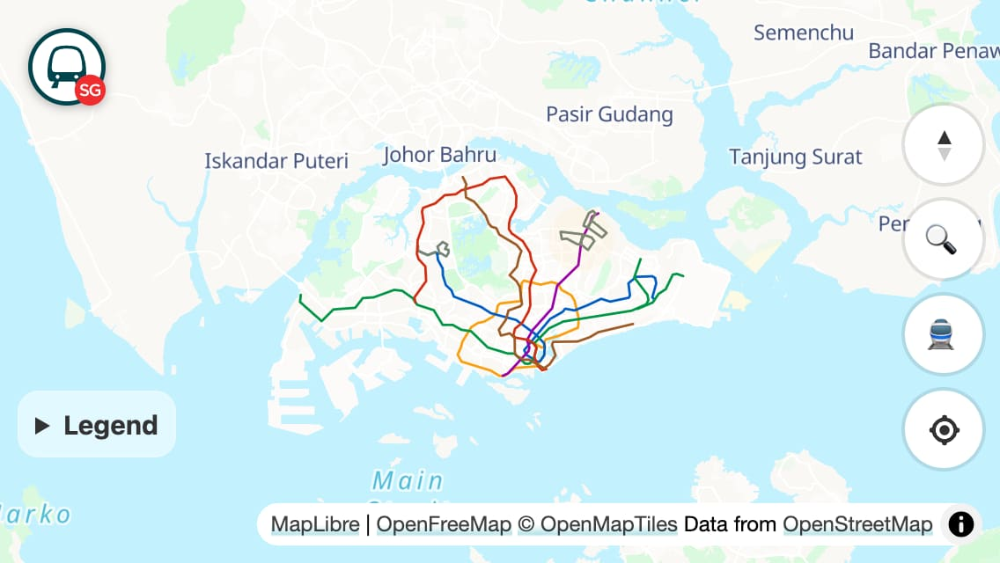
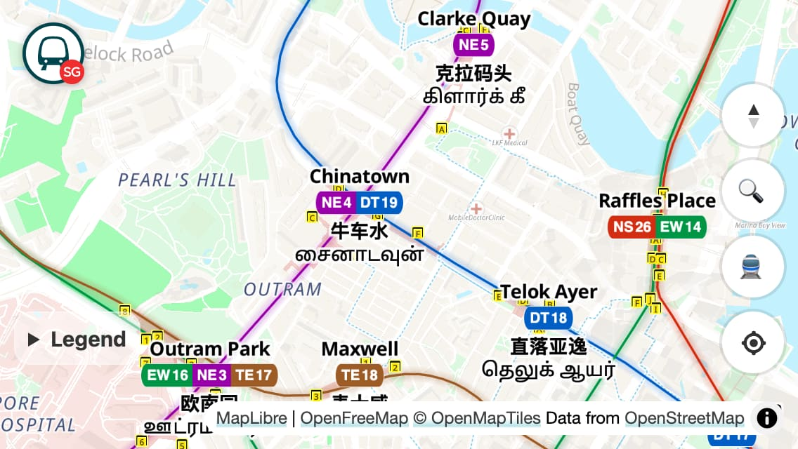
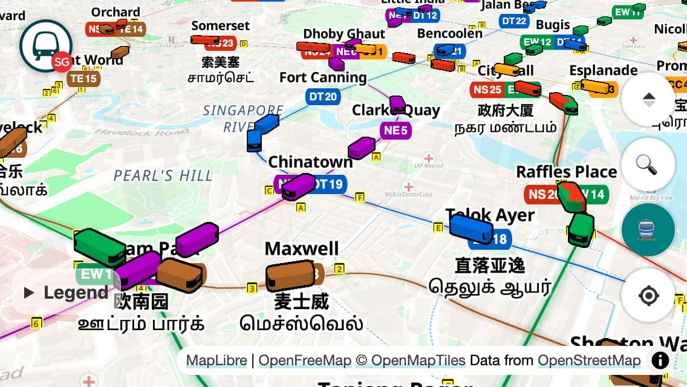
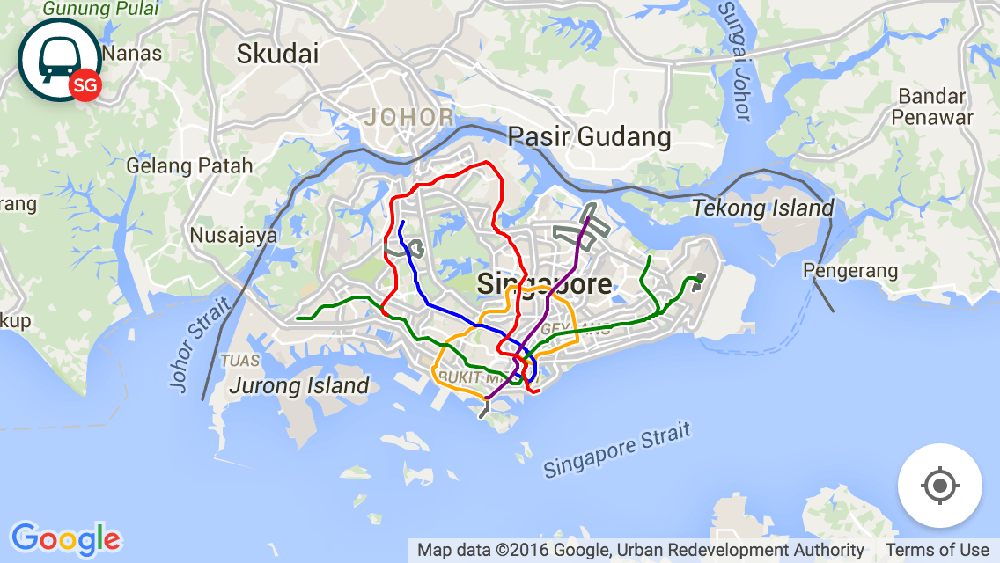

# RailRouter SG

**RailRouter SG** is a **progressive web app** that lets you explore MRT and LRT rail routes in Singapore.

It was built to [scratch my curiosity itch](https://twitter.com/cheeaun/status/683495506031448064) for comparing the _real_ route lines VS the lines shown on Google Maps, which I personally find too _straight_ and skews the perception of how trains actually travel in the real world.

Available features:

- **Real** rail route lines, for all train routes.
- Show station names in Chinese and Tamil, besides English.
- Show station building structures, both underground and aboveground.
- Show location of exits (a.k.a. entrances) for (almost) all stations.
- **Scheduled trains** animating along the tracks, from the published GTFS timetable.
- ~~Show train arrival times for _some_ stations.~~
- Possibly, **works offline**.

## Previously

This is the first version, using Google Maps.

## Technicalities

### For development

- `npm i` - install dependencies
- `npm start` - starts the server on http://localhost:1987
- `npm start-https` - same, over HTTPS
- `npm run build` - builds the production assets for deployment
- `npm test` - runs the unit tests

The port is pinned to **1987**, the year Singapore's MRT opened, rather than
Parcel's default.

### Scheduled trains

The 🚆 button on the map animates every train on the published timetable, and
`/#trains` opens the layer directly for sharing or bookmarking.

- `npm run gtfs` downloads LTA DataMall's GTFS Schedule (Train) feed and rebuilds
  `src/gtfs-trains.json`. It needs an account key in `LTA_ACCOUNT_KEY` or in
  `scripts/config.json` as `{ "accountKey": "..." }`. `GTFS_OFFLINE=1` rebuilds
  from the ZIP already cached in `data/` instead of downloading.
- `.github/workflows/update-gtfs.yml` reruns it twice a month and commits the
  regenerated JSON, so only the built timetable lives in git. The 3.3 MB source
  ZIP stays in the git-ignored `data/`. The build is deterministic — no
  timestamps — so an unchanged feed produces a byte-identical file and the
  workflow skips the commit.

`src/gtfs-trains.json` is a packed timetable, not raw GTFS: zig-zag varints over
base64 for time deltas, a delta-of-delta chain for track coordinates, and trip
polylines simplified to a 3 m tolerance with every stop vertex pinned. Codec
encode/decode lives in `src/gtfs-codec.mjs` and is shared by both the builder
and the app, so the two sides cannot drift; `src/gtfs-codec.test.mjs` covers the
round trips. The file is 530 KB raw but ~106 KB gzipped, and it is always served
compressed — that is the number to watch, not the raw size.

The trains themselves (`src/live-trains.js`) are drawn by one instanced WebGL
layer: the shader paints a rounded car per instance, so the CPU only writes a
small float buffer per frame and there is no GeoJSON source to parse or tile.
Movement comes from each path's cumulative distances and the trip's
arrival/departure profile, so trains dwell at stations and run between them at
the timetable's speed. Add `?trainsdebug` to the URL for per-frame timing.

### Data source

From my other repo: **[cheeaun/sgraildata](https://github.com/cheeaun/sgraildata)**.

### Generating station code markers

1. Go to https://codepen.io/cheeaun/full/pogQjgV
2. Paste all the train codes. (`/data/raw/sg-stations-codes.txt` from `sgraildata` repo)
3. Click "Generate Images" button to download ZIP file of SVG images.
4. Extract files from the ZIP file.
5. Go to https://www.facetstudios.com/sprite-generator
6. Drag/Upload all SVG files to the site.
7. Uncheck "Export for retina". Check "Generate JSON".
8. Click "Download Files" button.
9. Extract files from ZIP file.
10. Move & rename sprite image to `src/stations.png`. Optimize the image with [TinyPNG](https://tinypng.com/).
11. Move & rename sprite JSON to `scripts/sprite.json`.
12. Run `node scripts/gen-stations-sprite.js` which will generate `src/stations.json`.

### Map & tiles

Uses MapLibre GL JS with OpenFreeMap vector tiles — no API key. `src/basemap-style.json` is generated from OpenFreeMap's Bright style by `npm run gen-style` (`scripts/gen-basemap-style.mjs`).

### Tamil characters rendering

Tamil station names use MapLibre's `font-faces` feature with a self-hosted Noto Sans Tamil font (`src/fonts/`), so the browser shapes and rasterizes each grapheme cluster natively. The font is licensed under the SIL Open Font License (`src/fonts/OFL.txt`).

## License

- Data: © [LTA](https://www.lta.gov.sg/content/ltagov/en/terms-of-use.html) © [Data.gov.sg](https://data.gov.sg/privacy-and-website-terms#site-terms) © [SMRT](https://www.smrt.com.sg/Terms-of-Use) © [SBS](https://www.sbstransit.com.sg/conditions-for-use)
- Everything else: [MIT](http://cheeaun.mit-license.org/)
